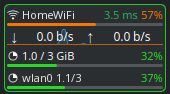
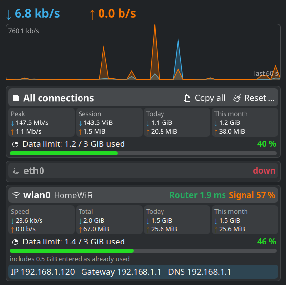

# Netspeed Widget (fork)

A KDE Plasma 6 panel widget that shows network speed, and on a click everything else about the
connection: a graph, usage counters, data limits, Wi-Fi signal, router latency, addresses and an
internet check.

Fork of [dfaust/plasma-applet-netspeed-widget](https://github.com/dfaust/plasma-applet-netspeed-widget)
3.1. It installs under its own name (`io.github.zebieksterc.netspeedwidget`, shown as
**Netspeed Widget (fork)**), so it can sit next to the original. License: GPL-2.0-or-later (see `LICENSE`).

Current version: see `package/metadata.json` and the top of `ChangeLog`. The first commit of this repository is the
unchanged original (tag `v3.1`); the fork follows (tag `v4.0`).

| In the panel | Details on a click |
|---|---|
|  |  |

**New here?** Read the [guide for first-time users](docs/GUIDE.md), with pictures. This README is the reference.

## What it shows

**In the panel**

- Download and upload speed, in two rows or on one line, with an optional small graph behind them.
- Optional line above the speeds: Wi-Fi icon, network name, router latency, signal in percent
  (as a filled bar, or as text with a thin bar). A wired connection is named there too.
- Optional line below for each data limit: used / limit, percentage, thin bar. The frame of the widget takes
  the limit's colour: green up to half, then gradually through yellow and orange to red at the limit.
- Optional frame, dimming while not connected, a small mark while idle.
- Mouse: click opens the details (or launches an application), middle click copies the IP address,
  the wheel switches between bits and bytes.
- Tooltip: totals, today, limits, Wi-Fi signal, network name, router latency, data source, version.

**In the details popup**

- Current speeds and a graph of the last 60 readings.
- Box *All connections*: tiles for peak, session, today and this month; limits that count all connections;
  **Copy all** (addresses as text) and **Reset …** (peak and session, today, this month, data limits, history, everything).
- One box per interface: name, network name, router latency, Wi-Fi signal; tiles for speed and total
  (and today / this month when per-interface counting is on); that interface's data limit;
  the IPv4 addresses and, when the connection has IPv6, a second strip with the IPv6 address, gateway and DNS.
  A click on an address strip copies the address. An interface that is down shows only its header.
- History: the last 12 months (3 shown, all on a click). It appears when the first month has ended.
- Box *Internet*: a **Check** button fetches the external IP address and pings an internet host.
  Nothing is sent to the internet unless this button is pressed (or the matching option is switched on).

**Notifications** (kept in Plasma's notification history): connection lost and restored, Wi-Fi signal weak,
data limit at 80 % and reached, IP address copied.

## Install

    git clone https://github.com/zebieksterc/netspeed-widget.git
    cd netspeed-widget
    ./install.sh

Then right-click the panel > *Add or Manage Widgets* > search for "Netspeed" and add
**Netspeed Widget (fork)**. Settings of the original widget are not taken over. No root is needed.

Without git: download the `.plasmoid` file of a [release](https://github.com/zebieksterc/netspeed-widget/releases), then right-click the panel >
*Add or Manage Widgets* > *Get New* > *Install Widget From Local File*, or run
`kpackagetool6 --type Plasma/Applet --install <file>` (`--upgrade` when an older version is installed).
The scripts of this repository (`check.sh`, rollback with `install.sh`) are not part of that file.

## Update, try, roll back

    git pull --tags
    ./install.sh
    ./check.sh --try          # runs the widget in a window of its own; a crash there cannot take the desktop down
    systemctl --user restart plasma-plasmashell.service     # only after --try said "closed normally"
    ./check.sh

    ./install.sh --list       # all versions (git tags)
    ./install.sh v4.0         # install another version (rollback), then restart Plasma

If Plasma itself keeps crashing after an update: run `./install.sh <last good version>` from any terminal
(Ctrl+Alt+T, or Ctrl+Alt+F3 for a text console) and restart Plasma. Last resort:
`rm -rf ~/.local/share/plasma/plasmoids/io.github.zebieksterc.netspeedwidget` - settings and counters stay.

## Health check

    ./check.sh

Read-only, about 3 seconds: tools, Plasma modules, installed files, a live sample from both data sources,
and messages about the widget in the journal. The lines "Created graphical object was not placed in the
graphics scene" for the settings pages are harmless.

## Uninstall

Remove the widget from the panel, then `./uninstall.sh`. (`./uninstall.sh --original` removes the original 3.1.)

## Settings

Nearly every option explains itself when the mouse rests on it. An option that has no effect in the current
combination is dimmed, most of them with a warning triangle that gives the reason.

| Tab | Options |
|---|---|
| General | Layout, display order, speed units, show units / short units / arrows, separate or combined speeds, speeds below 1 kb/s, font size (10-200 %), update interval (1-10 s), custom colours |
| Appearance | Decimal places, digits of equal width, graph, frame, Wi-Fi signal bar, signal in percent and where it goes (left, inside a wider bar, right, own line as bar, own line with thin bar), size of the details (80-200 %), shrinking while idle and the speed below which it counts as idle |
| Connection | Dim while not connected, connection notifications, weak-signal level, router latency and its interval, internet check host, external IP service, check when the details open |
| Data limits | Which limits the widget shows (connection in use / all / none), day on which "This month" starts, counting per interface, and up to 8 limits: connection (all or one interface), limit in GiB, month start day, already used, reset, remove |
| Advanced | Launch an application on click, count only selected interfaces, mouse options |

Notes:

- Font size: in a vertical panel the speeds fill the width at 100 %; more only enlarges the extra lines.
- With *Launch application on click* the details open from the right-click menu (*Show details*).
- The details popup has one size, set with *Size of the details*; it cannot be dragged.

## How the numbers are made

- **Speeds** come from Plasma's system-monitor sensors: no process per update. The sensors report physical
  devices only (Ethernet, Wi-Fi, Bluetooth, modem), so traffic through a VPN, bridge or container is not
  counted twice. With *selected interfaces*, while the details are open, or when the sensors give no data,
  `/proc/net/dev` is read instead (one short `awk` process per update).
- **Counters**: at every update the change of the byte counters is added to session, today and this month.
  A counter that jumps or runs backwards (standby, reconnect) is replaced by speed x time for that interval.
  Saved every 5 minutes and at logout, together with the position of the byte counters. At the next start
  the widget adds what was transferred since that position to today, this month and the limits (not to
  "session"): a Plasma restart or crash loses nothing. After a reboot the counters start from zero, so
  everything since boot is added, and at most the last 5 minutes before the shutdown are missing.
- **Per-interface counters** use each interface's own byte counter, read by one short process every 30 seconds
  (every 5 seconds while nothing is transferred, and with every update while the details are open);
  they catch up in the same way.
- **A data limit** compares download plus upload of its period with the limit (1 GiB = 1024^3 bytes), plus the
  "already used" figure. Each limit has its own start day, is warned about once at 80 % and once at 100 %
  per period, and its "already used" figure goes back to 0 when the period ends.
  Clean start for a real data plan: choose connection and start day, Apply, *Reset this limit now*,
  enter the provider's figure under *Already used*, Apply.
- **Router latency**: one `ping` to the gateway at the chosen interval; nothing leaves the local network.
- **Internet check**: one `ping` to the chosen host (default 1.1.1.1) and one https request to the external IP
  service (default https://api.ipify.org), only on request. The service sees the public IP address, the time
  and the system language. The answer is only accepted if it looks like an IP address.

## Requirements

- **Must have:** KDE Plasma 6 (developed and run on Plasma 6.8; other Plasma 6 versions are untested), `kpackagetool6`, and the QML modules that come with a Plasma 6
  desktop: `org.kde.plasma.plasmoid`, `org.kde.plasma.core`, `org.kde.plasma.components`, `org.kde.plasma.extras`,
  `org.kde.plasma.configuration`, `org.kde.kirigami`, `org.kde.kcmutils`, Qt Quick Controls, Layouts and Dialogs,
  `Qt.labs.platform`.
- **With a fallback:** system monitor sensors (`ksystemstats`, `org.kde.ksysguard.sensors`) - else `/proc/net/dev`;
  NetworkManager - else no network name, signal or addresses.
- **`org.kde.plasma.plasma5support` and `awk`:** the widget itself still shows speeds from the sensors without
  them, but every small command needs them (the `/proc` mode, selected interfaces, notifications, clipboard,
  latency, launch on click), and the settings pages Data limits and Advanced cannot open without the module.
- **Per feature:** `notify-send` (notifications), `qdbus6` and Klipper (clipboard), `ip` (middle-click copy),
  `ping` and `timeout` (router latency, internet check), `kstart` or `gtk-launch` (launch on click).
- **For the scripts:** `bash`, `git`, `sed`, `tar`, `mktemp`, `readlink`; optional `kbuildsycoca6` (install),
  `plasmawindowed` (`./check.sh --try`), `journalctl`, `qtpaths6`, `kstatsviewer` (check).

## Files

| Path | Created by | Content |
|---|---|---|
| `~/.local/share/plasma/plasmoids/io.github.zebieksterc.netspeedwidget/` | `install.sh` | The widget (`package/` of this repository) |
| `~/.local/share/applications/io.github.zebieksterc.netspeedwidget.desktop` | `install.sh`, or the widget when it starts | Hidden entry that makes Plasma keep the notifications |
| `~/.config/plasma-org.kde.plasma.desktop-appletsrc` | Plasma | Settings, limits and counters of the widget (one section) |

When it starts, the widget puts the hidden entry in place itself if it is missing or differs from the one in
the package (for a widget installed from a `.plasmoid` file); the entry starts no program. Removing the widget
through Plasma leaves that one file behind; `./uninstall.sh` removes it.

The widget writes nothing else. It reads `/proc/net/dev` and `/sys/class/net/`, and talks to the system sensors
and NetworkManager over D-Bus. Also:

- `install.sh` uses a temporary folder (removed at the end) and refreshes KDE's application cache (`kbuildsycoca6`).
- Text that is copied (addresses, Copy all) goes into Klipper's clipboard history like any other copied text.
- In the settings file the widget's section has the groups `General`, `Advanced` and `Extras`. "Extras" is only
  the name of that group: it holds everything the fork added, although no tab is called so any more.
- Qt keeps compiled copies of the QML files in `~/.cache/plasmashell/qmlcache/`; they are rebuilt when needed.

## This repository

| Path | What it is |
|---|---|
| `package/` | The widget: `metadata.json`, `contents/ui/` (QML), `contents/code/utils.js` (all calculations), `contents/config/` (settings) |
| `install.sh`, `uninstall.sh`, `check.sh` | Install / rollback, remove, health check and safe try-out |
| `package/contents/data/io.github.zebieksterc.netspeedwidget.desktop` | The notification entry installed next to the widget |
| `.github/workflows/build.yml` | GitHub Actions: tests, builds the `.plasmoid` file, publishes a release for a version tag |
| `ChangeLog` | What each version changed, newest first |
| `tests/helpers.test.js` | Tests of the calculations (`node tests/helpers.test.js package/contents/code/utils.js`) |
| `tests/harness/` | Runs the widget's QML without Plasma: layout, clicks, all setting combinations, rebuild counter |
| `docs/DEVELOPMENT.md` | How the widget is built, the rules learned, how to test |
| `docs/README_upstream.md`, `docs/README_upstream.png` | README and screenshot of the original widget |
| `docs/GUIDE.md`, `docs/guide/` | Guide with pictures for first-time users |
| `docs/panel.png`, `docs/details.png` | The pictures above |

History: `git diff v3.1 v4.0` shows everything the fork changed. Five files of the original that the fork does not
use were removed (`CMakeLists.txt`, `release.sh`, `run.sh`, `netspeed-widget.png`, `package/contents/ui/Launcher.qml`);
the screenshot of the original is kept as `docs/README_upstream.png`.

Problems and questions: https://github.com/zebieksterc/netspeed-widget/issues

Copyright 2016-2024 Daniel Faust and contributors (Netspeed Widget 3.1); changes of the fork 2026 zebieksterc.
GPL-2.0-or-later.
