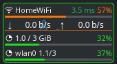
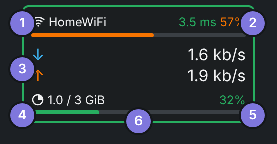
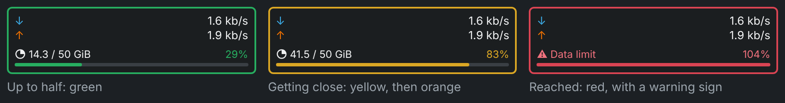
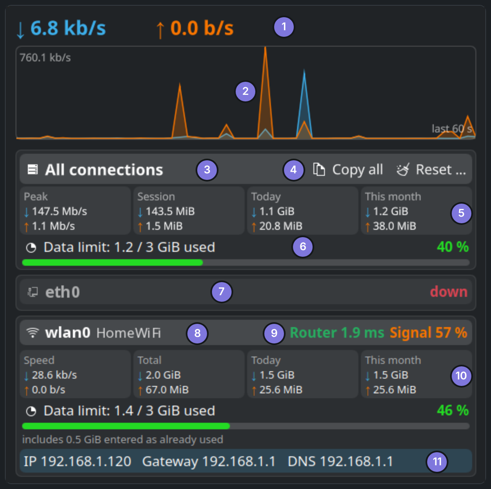
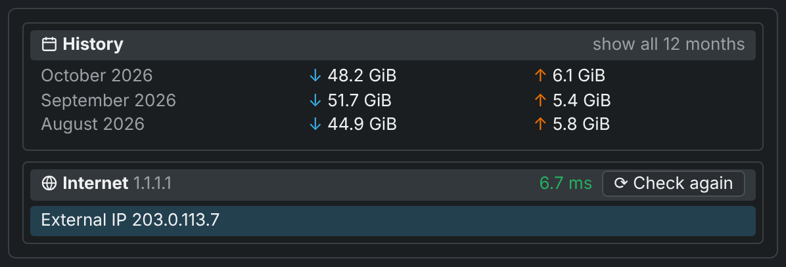
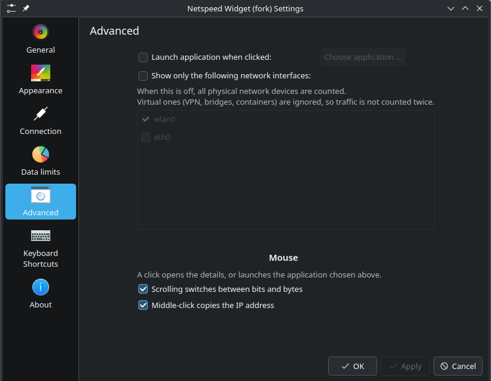
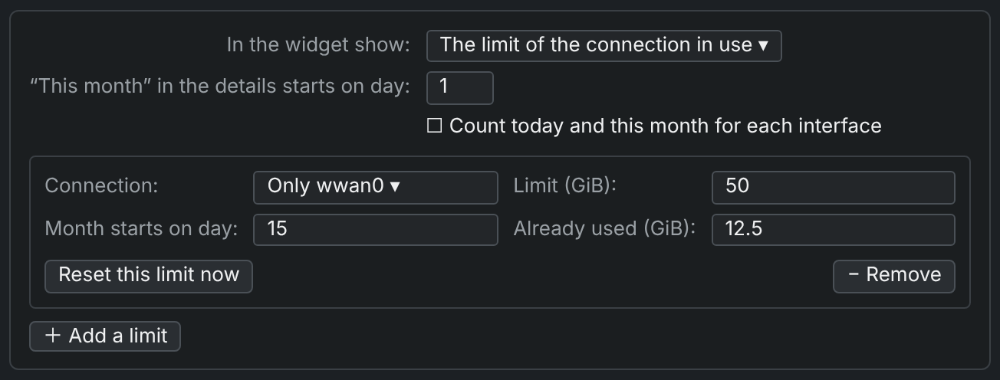

# Netspeed Widget (fork) – guide for first-time users

A small widget for the KDE Plasma 6 panel. It shows how fast your network is right now, and with one click everything else about the connection.

This guide is for version 4.0. The reference is the [README](../README.md).



## Contents

1. [What it is](#1-what-it-is)
2. [Install it](#2-install-it)
3. [The widget in the panel](#3-the-widget-in-the-panel)
4. [The details popup](#4-the-details-popup)
5. [Mouse actions](#5-mouse-actions)
6. [Settings, tab by tab](#6-settings-tab-by-tab)
7. [Data limits, step by step](#7-data-limits-step-by-step)
8. [Notifications](#8-notifications)
9. [Update, try out, go back](#9-update-try-out-go-back)
10. [When something goes wrong](#10-when-something-goes-wrong)
11. [How the numbers are made](#11-how-the-numbers-are-made)
12. [Requirements and files](#12-requirements-and-files)

## 1. What it is

The widget sits in your Plasma panel and shows the current download and upload speed. That is all it does until you switch more on. Everything else is optional:

| You want to know… | The widget shows it as… |
|---|---|
| How fast is it right now? | Two numbers in the panel, with an optional small graph behind them. |
| Which network am I on, how good is the Wi-Fi? | A line with the network name, the signal in percent and the delay to your router. |
| How much have I used? | Counters for this session, today and this month, per connection if you like. |
| Am I close to my data plan's limit? | A line with used / limit, and a frame that turns from green to red. |
| What are my addresses? | IP, gateway and DNS in the details; one click copies them. |
| Is the internet itself reachable? | A *Check* button that asks only when you press it. |

> [!NOTE]
> It is a fork (an improved copy) of the widget “Netspeed Widget” 3.1 by Daniel Faust. Both can be installed side by side; this one is listed as **Netspeed Widget (fork)**.

## 2. Install it

You need KDE Plasma 6, a terminal (for example Konsole) and `git`. No administrator password is needed. The full list of what the widget uses is in [chapter 12](#12-requirements-and-files).

Without git you can also download the `.plasmoid` file of a [release](https://github.com/zebieksterc/netspeed-widget/releases) and install it with *Add or Manage Widgets → Get New → Install Widget From Local File*. The try-out, health check and going back to an older version described below need the folder from git.

1. **Get the folder** with git:

   ```bash
   cd ~
   git clone https://github.com/zebieksterc/netspeed-widget.git
   cd netspeed-widget
   ```

2. **Install.**

   ```bash
   ./install.sh
   ```

   It copies the widget into your home folder and says “Installed”.

3. **Try it in a window of its own.** This is the safe way to see that it runs on your system:

   ```bash
   ./check.sh --try
   ```

   A small window with the widget opens. Click it, look around, close the window. The script then says whether it ran cleanly.

4. **Put it in the panel.** Right-click the panel → *Add or Manage Widgets* → search for “Netspeed” → drag **Netspeed Widget (fork)** into the panel.

5. **Check.**

   ```bash
   ./check.sh
   ```

   No line should start with `[FAIL]`. Lines with `[warn]` name optional things that are missing; a warning about “graphics scene” messages is harmless.

To open the settings later: right-click the widget → *Configure Netspeed Widget (fork)…*

## 3. The widget in the panel

The picture shows the widget with every optional line switched on, drawn larger than life. Fresh after installing you only see the two speed rows (3).



1. **Network name.** The Wi-Fi you are connected to, or the name of the cable connection. A long name is cut with “…”; the tooltip shows it in full. *(off by default)*

2. **Router delay and Wi-Fi signal.** How many milliseconds your router takes to answer, and the signal strength. Green is good, yellow fair, red poor. The bar under the line shows the signal too. *(off by default)*

3. **Speeds.** ↓ download, ↑ upload. They can also share one line.

4. **Data limit.** How much of a limit you set is used. One line per limit that applies to the connection in use. *(off by default)*

5. **Percentage of the limit,** in the limit's colour.

6. **Frame.** With a limit shown, the frame takes its colour: green up to half, then step by step through yellow and orange to red.

This is how it really looks in a narrow vertical panel, here with two limits:


### The frame tells you about your data limit



### Other things you may see

| | |
|---|---|
| The whole widget is pale | No network connection. |
| Only a pale “↓↑” | Nothing is being transferred and *Shrink while idle* is on. It comes back with the first traffic. |
| A short blue flash | You middle-clicked: the IP address was copied. |
| A box with a percentage at the left | The Wi-Fi signal, in one of its other positions (see Settings → Appearance). |

**Rest the mouse on the widget** for the tooltip: totals, today's usage, limits, signal, network name, router delay and the version.

## 4. The details popup

**Click the widget** and the details open. Click again, or anywhere else, to close them.



1. **Current speed**, large.

2. **Graph** of the last 60 readings. The number at the top left is the height of the scale.

3. **All connections.** Everything below in this box counts all your network devices together.

4. **Copy all** puts every address on the clipboard as text. **Reset …** offers what to set back to zero.

5. **Four tiles:** the highest speed seen, this session (since login), today, this month.

6. **Data limit** for all connections, with its bar.

7. **A device that is not connected** is one short line.

8. **A connected device:** its name and the network it is on.

9. **Router delay and Wi-Fi signal.**

10. **Tiles for this device:** speed, total since it connected, today, this month; below them its own data limit.

11. **Addresses.** Click the line and the IP address is on the clipboard. With IPv6 a second strip appears below.

Below these boxes there are two more:



Drawn with example values. **History** appears once the first month has ended. **Internet:** press *Check* and the widget asks an internet service for your public address and measures the delay to an internet server. Nothing is sent to the internet until you press it (or switch on *Also check every time the details open* in the settings).

> [!NOTE]
> The popup too large or too small? *Settings → Appearance → Size of the details* makes everything in it grow or shrink together (80 % to 200 %).

## 5. Mouse actions

| Do this on the widget | What happens |
|---|---|
| Left click | Opens or closes the details. (Or starts an application, if you set one under Advanced.) |
| Middle click | Copies the IP address of this computer. The widget flashes and a notification confirms it. |
| Mouse wheel | Switches between bits (kb/s, Mb/s) and bytes (KiB/s, MiB/s). |
| Rest the mouse | Shows the tooltip. |
| Right click | The menu with *Configure…*; and *Show details* when a left click starts an application. |

In the details: click an address strip to copy that address, click the *History* header to see all months, rest the mouse on a tile to read its values in full.

## 6. Settings, tab by tab

Right-click the widget → *Configure Netspeed Widget (fork)…* The settings have five tabs of their own.



The settings window. The tabs are at the left; this is *Advanced*.

> [!NOTE]
> **Two helpers in every tab.** Rest the mouse on any option and a description appears. An option that cannot have an effect with your current choices is greyed out and gets a small ⚠ – rest the mouse on it to read why.

### General – how the speeds look

| | |
|---|---|
| Layout | *Automatic*, *Above each other* (two rows) or *Side by side* (one line). |
| Speed units | *Bits* (kb/s, as providers state speeds) or *Bytes* (KiB/s, as download windows show them). 8 bits are 1 byte. |
| Show speed units / shortened | “kb/s” after each number, or just “k”, or nothing. |
| Show download and upload separately | Off: one number, the sum of both. |
| Show speeds below 1 kb/s | Off: tiny background traffic shows as 0.0, so the numbers do not flicker. |
| Font size | In a vertical panel the speeds already fill the width at 100 %; more only enlarges the extra lines. |
| Update interval | 1 to 10 seconds. |
| Use custom colours | Colours the numbers by size, so a fast transfer stands out. |

### Appearance – what else is drawn

| | |
|---|---|
| Decimal places, digits of equal width | 1.3 or 1; and numbers that stay in place while they change. |
| Small graph behind the numbers | The last 60 readings as two faint curves. |
| Frame around the widget | A thin border with a faint background. |
| Wi-Fi signal bar / in percent | A thin bar at the left edge, and the signal as a number. |
| Position of the percentage | Left, inside a wider bar, right – or **on a line of its own with the network name** (as a filled bar, or as text with a thin bar). This is line 1 and 2 in the picture above. |
| Size of the details | 80 % to 200 %. |
| Shrink to a small mark while idle | After 5 seconds below the speed you set. |

### Connection – watching the link

| | |
|---|---|
| Dim the widget while not connected | On by default. |
| Notify when the connection is lost or returns | A desktop notification each time. |
| Warn when the Wi-Fi signal stays below … | One notification after a full minute below the level. 30 is a sensible value; 0 switches it off. |
| Latency to the router | Measures the delay to your router every few seconds. Nothing leaves your home network. |
| Internet check | Which server the *Check* button asks (empty = 1.1.1.1), which service tells your public address, and whether to check each time the details open. |

### Data limits – your data plan

See the [next chapter](#7-data-limits-step-by-step).

### Advanced

| | |
|---|---|
| Launch application when clicked | A left click then starts a program (a system monitor, for example). The details move to the right-click menu. |
| Show only the following network interfaces | Count only the devices you tick – for example only the VPN. |
| Mouse | Switch the wheel and the middle click on or off. |

## 7. Data limits, step by step

A data limit compares what you transferred in a month (download plus upload) with a number you set, and warns you at 80 % and at 100 %. You can have up to eight limits – for example one for a mobile connection and one for everything.



The *Data limits* tab with one limit (drawn).

### Setting one up for a real data plan

1. Open *Settings → Data limits* and press **Add a limit**.

2. **Connection:** choose *All connections*, or only the device the plan belongs to (a mobile modem or a tethered phone), so that home Wi-Fi does not count.

3. **Limit:** the size of your plan in GiB. **Month starts on day:** the day your plan renews.

4. Press **Apply**, then **Reset this limit now**. The limit starts from zero.

5. **Already used:** enter what your provider says you have used so far this month. Press **Apply**.

From now on the widget counts on top of that figure. When the next month of the plan starts, the counter and the “already used” figure go back to zero by themselves.

> [!WARNING]
> **The widget can count less than your provider.** For *All connections* it only counts while you are logged in. A limit on one device is closer to the provider's number, because it reads that device's own counter. Also, 1 GiB is a little more than a provider's “GB” (50 GiB ≈ 53.7 GB).

**Which limit appears in the panel?** By default the one for the connection you are using right now, plus a limit for all connections. The box at the top of the tab can change that to all limits or none.

## 8. Notifications

All of them stay in Plasma's notification history (the bell in the system tray), so you can read them later.

| Notification | When | Switch it on under |
|---|---|---|
| Network disconnected / connected | The last connection is lost, or one is back. | Connection |
| Wi-Fi signal weak | The signal stayed below your level for a minute. Once, until it has recovered. | Connection |
| Data limit: 80 % used / reached | Once each per limit and month. | Data limits (automatic) |
| IP address copied | After a middle click. | Advanced (on by default) |

## 9. Update, try out, go back

Every version is kept, so you can always return to an earlier one.

```bash
cd ~/netspeed-widget
git pull --tags
./install.sh
./check.sh --try
systemctl --user restart plasma-plasmashell.service
./check.sh
```

> [!WARNING]
> **Always run `./check.sh --try` before restarting Plasma.** It runs the new version in a window of its own. If it crashes there, only that window disappears. Restart Plasma only when it says “ran and was closed normally”.

### Going back to an older version

```bash
./install.sh --list      # all versions
./install.sh v4.0        # install that one
systemctl --user restart plasma-plasmashell.service
```

### Removing it

Take the widget out of the panel (right-click → *Remove*), then run `./uninstall.sh`. Taking it out of the panel also deletes its settings and counters.

## 10. When something goes wrong

| What you see | What to do |
|---|---|
| The widget is not in *Add or Manage Widgets* | Run `./install.sh` again, then `./check.sh`. |
| Speeds stay at 0 | Run `./check.sh`: the part “Live data” shows whether the system delivers numbers. |
| No network name, signal or addresses | These come from NetworkManager. Without it only speeds and counters work. |
| “Router: no answer” | Some routers do not answer the test. The connection can still be fine. |
| “External IP not available” | No internet, or the service did not answer within 10 seconds. Press *Check again*. |
| The data limit shows less than my provider | See the warning in [Data limits](#7-data-limits-step-by-step). Correct it with *Already used*. |
| A setting is grey with a ⚠ | It has no effect with your other choices. Rest the mouse on the ⚠ for the reason. |
| Settings changes do nothing | Press **Apply**. The only buttons that act at once are the reset buttons. |

> [!CAUTION]
> **If the desktop (panel, wallpaper) disappears or keeps restarting** after installing a new version, open a terminal – <kbd>Ctrl</kbd>+<kbd>Alt</kbd>+<kbd>T</kbd>, or <kbd>Ctrl</kbd>+<kbd>Alt</kbd>+<kbd>F3</kbd> for a text screen – and go back to the last version that worked:
>
> ```bash
> cd ~/netspeed-widget
> ./install.sh --list       # choose the last one that worked
> ./install.sh v4.0
> systemctl --user restart plasma-plasmashell.service
> ```
>
> If even that does not help, take the widget out completely. Your settings and counters stay:
>
> ```bash
> rm -rf ~/.local/share/plasma/plasmoids/io.github.zebieksterc.netspeedwidget
> systemctl --user restart plasma-plasmashell.service
> ```

## 11. How the numbers are made

| | |
|---|---|
| **Speeds** | Read from Plasma's own system monitor, so the widget starts no extra program for them. Only real devices count (cable, Wi-Fi, modem); a VPN or a virtual machine's network is left out, so nothing is counted twice. |
| **Counters** | At every update the widget adds what was transferred since the last one. They are saved every 5 minutes and at logout. When the widget starts, it adds what was transferred while it was not running, so restarting Plasma loses nothing; what arrives this way counts for the day it is noticed on. Only after the computer itself was switched off can up to 5 minutes be missing. |
| **Today / This month** | Start again at midnight, and on the day you set as the start of the month. A finished month moves to *History* (12 are kept). |
| **Per device** | With *Count today and this month for each interface* the widget reads each device's own counter every 30 seconds. |
| **Router delay** | One “ping” to your router at the interval you choose. |
| **Internet check** | One ping to a server (1.1.1.1 unless you change it) and one request to a service that answers with your public address (api.ipify.org unless you change it). That service sees your address, the time and your system language; the pinged server sees your address. It only happens when you press *Check*, or each time the details open if you switched that option on. |

## 12. Requirements and files

### What it needs

| | |
|---|---|
| **Must have** | KDE Plasma 6 (it was built and used on Plasma 6.8.3). |
| **For names, signal, addresses** | NetworkManager, which nearly every desktop Linux uses. |
| **For single features** | `notify-send` (notifications), Klipper and `qdbus6` (copying), `ping` (delay), `ip` (middle-click copy). |
| **For installing** | `git` and `bash`. |

`./check.sh` tests all of this on your computer and marks what is missing.

### What it puts on your computer

| | |
|---|---|
| `~/.local/share/plasma/plasmoids/io.github.zebieksterc.netspeedwidget/` | The widget itself. |
| `~/.local/share/applications/io.github.zebieksterc.netspeedwidget.desktop` | A small hidden entry so that notifications are kept. |
| `~/.config/plasma-org.kde.plasma.desktop-appletsrc` | Plasma's file for all panel widgets; this widget keeps its settings and counters in one section of it. |

Nothing is written outside your home folder, and no administrator rights are used.

### Where to read more

In the widget's folder: `README.md` (reference), `ChangeLog` (what changed in each version), `docs/DEVELOPMENT.md` (for changing the widget).

---

Problems and questions: https://github.com/zebieksterc/netspeed-widget/issues

Netspeed Widget (fork) 4.0 · fork of dfaust/plasma-applet-netspeed-widget 3.1 · GPL-2.0-or-later. Screenshots from Plasma 6.8.3; drawn pictures use example values.
